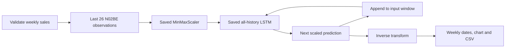

# Pharmaceutical sales forecasting

**Sales, in season.** A Streamlit dashboard exploring eight pharmaceutical sales categories and 1–12-week N02BE projections. Built by Sebastian Latiphy.

The planning question: can historical sales patterns help inform spring purchasing reviews and lead-time planning? Explore the data, generate an exploratory projection and inspect the evidence before making that decision.

**Live dashboard:** https://forecast-of-drug-pharma-demand.streamlit.app/
## Explore the dashboard

- **Overview:** the project and six years of observed N02BE sales.
- **Sales history:** interactive charts for all eight categories, with a data table.
- **Seasonal patterns:** monthly average weekly sales and potential planning applications.
- **Forecast:** selectable 1–12-week recursive LSTM projections, historical context, a forecast boundary, table and CSV download.
- **Model & evidence:** matched fixed-origin benchmark scores and limitations.

The design follows [latiphy.com](https://www.latiphy.com/): warm charcoal, amber accents, ivory text and editorial serif headings.

## Local setup

Use **Python 3.12**. From this project folder:

```bash
python3.12 -m venv .venv
source .venv/bin/activate
python -m pip install -r requirements.txt
python -m streamlit run app.py
```

On Windows, activate with `.venv\Scripts\activate`.

The dashboard needs no API key or external service. The first launch loads TensorFlow; subsequent interactions reuse the cached model. Projections are cached by horizon and file hashes. Nothing is retrained by the app.

### Required files

```text
app.py
forecasting.py
evaluation.json
forecast_metadata.json
pharma_lstm_model.keras
scaler.pkl
data/iqvia_pharma_sales.csv
.streamlit/config.toml
requirements.txt
```

Keep the model, scaler and metadata from the same notebook export together. The supplied all-history scaler was fitted on 313 observations. The app validates model shape, metadata, scaler range/sample count, missing or nonnumeric sales, invalid/duplicate dates, negative values and seven-day continuity. Missing or inconsistent inputs produce an explicit error. It never substitutes an `.h5` model.

`scaler.pkl` is a trusted local notebook artifact. Do not replace it with an untrusted pickle. `artifact_manifest.json` records SHA-256 hashes of the supplied notebook, data and inference artifacts.

## How projections work



The model uses only historical N02BE values. It has LSTM layers with 64 and 32 units, dropout layers and dense layers with 16 and 1 units. The notebook selected seven training epochs using pre-test validation, then trained a separate all-history model for inference.

The app reproduces `recursive_forecast` from notebook cell 24. Each prediction is appended to the scaled input window to predict the following week. There are no seasonal multipliers, artificial fluctuations or invented confidence intervals. Dates are exactly seven days apart.

With this dataset, the forecast origin is **25 December 2023**. Projections cover **1 January to 18 March 2024** at the maximum horizon. They are exploratory historical sales projections, not forecasts for today.

## Findings and potential business applications

N02BE monthly average weekly sales peak in March–May in this dataset. The pattern does not establish a clinical cause. March 2020 is an exceptional high-sales month. N02BA and N02BE move together, but correlation does not demonstrate patient switching.

- **Spring purchasing reviews:** review supplier capacity and delivery schedules before the observed high-sales period, after confirming the pattern in recent data.
- **Lead-time planning:** combine projections with inventory, expiry dates, service targets and delivery constraints.
- **Candidate signals:** test lagged related-category sales against a target-history-only baseline.
- **Measure value:** compare stockout days, expiry waste and inventory costs in a replenishment pilot before wider use. No inventory savings have been measured.

## Matched-origin evaluation

Source: `pharma-drug-demand-forecasting-iqvia.ipynb`, section 6, cell 29 saved outputs. `evaluation.json` is transcribed from those tables, retaining their displayed precision.

All models use the same origin, **14 November 2022**, and receive no test-period observations. The 12-week period is **21 November 2022 to 6 February 2023**. The full 58-week holdout ends **25 December 2023**.

| Model | 12-week MAE | 12-week RMSE | 58-week MAE | 58-week RMSE |
|---|---:|---:|---:|---:|
| Prophet | 1639.275 | 2065.981 | 3551.134 | 4596.433 |
| LSTM recursive | 2612.263 | 3558.615 | 6299.634 | 7631.701 |
| Seasonal naive (52 weeks) | 4041.085 | 4637.211 | 3617.887 | 4434.821 |
| ARIMA(2,1,2) | 8384.795 | 10506.279 | 16611.553 | 21154.740 |
| Persistence | 8415.726 | 10536.641 | 16644.308 | 21190.713 |

Errors are in Extended Units. These are scores for the pre-test evaluation models, not the all-history inference model. One origin cannot establish a best model or statistical superiority. ARIMA is an untuned, nonseasonal baseline. Evaluate multiple origins and decision horizons before selecting a model.

## Limitations

The 313 observations cover January 2018 through December 2023. The CSV labels its market Northeast US, its units Extended Units and its source IQVIA MIDAS; provenance is not independently verified. Sales are not unconstrained demand and can be affected by stock availability. There are no quantified prediction intervals, recent observations or measured procurement benefits. Recursive errors can accumulate as the horizon grows. An all-history refit is not independently evaluated by the earlier holdout scores.
