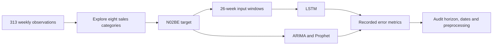

# Pharmaceutical sales forecasting

A notebook study of weekly pharmaceutical sales, comparing an LSTM with ARIMA and Prophet. The central evaluation question is how the forecast horizon and available observations affect the comparison.

[Read the portfolio case study](https://www.latiphy.com/projects/forecast-of-drug-pharma-demand)

## Recorded results

These are saved notebook results, not a new training run or a matched-horizon benchmark.

| Model | MAE | RMSE | R² | MAPE |
|---|---:|---:|---:|---:|
| LSTM | 3,122.46 | 3,945.13 | 0.9212 | 4.07% |
| Prophet | 4,392.99 | 5,719.13 | 0.8343 | 5.63% |
| ARIMA | 12,713.74 | 14,164.37 | -0.0162 | 18.26% |

The LSTM uses recent observed test-period sales for rolling one-step predictions. ARIMA and Prophet forecast the whole test period from one origin. Their scores are therefore not a controlled ranking of model quality.

## Workflow



The data spans 2018-01-01 to 2023-12-25. Feature preparation leaves 261 rows, yielding 188 training sequences and 47 test sequences. The LSTM has two recurrent layers, dropout and dense output layers. A separate exploratory scenario recursively forecasts 12 weeks with seasonal adjustment.

## Run locally

Use Python 3.11 in a virtual environment:

```sh
python -m venv .venv
source .venv/bin/activate
pip install -r requirements.txt
jupyter lab
```

Open `pharma-drug-demand-forecasting-iqvia.ipynb`. Its saved outputs are retained. The original Kaggle loader path in cell 6 must be replaced with `data/iqvia_pharma_sales.csv` for a local run. The `/kaggle/input` listing cell can be skipped. Training creates model and scaler files, which are ignored by Git. Dependencies below are an unpinned starting environment, not an exact reconstruction of Kaggle; saved output reports TensorFlow 2.19.0. Hardware and dependency changes may change results.

## Evaluation limitations

- The scaler is fitted before splitting. Refit using training observations only.
- Engineered domain features are not inputs to the univariate LSTM, so their claimed improvement is not established.
- Prophet's generated Sunday dates need alignment with the Monday observations.
- The future plot's fixed ±8% band is illustrative, not a calibrated 90% confidence interval.
- Correlations do not establish patient substitution or clinical causes. Sales are not necessarily unconstrained demand.
- No runnable Streamlit app or trained model is included. No inventory savings were measured.

[Detailed notebook audit](docs/notebook-audit.md) distinguishes saved results from claims requiring further evaluation. A next experiment should use matched rolling forecast origins, train-only preprocessing, a seasonal-naive baseline and measured interval coverage.

## Data and provenance

The supplied CSV contains aggregated category sales and labels its source as IQVIA MIDAS. This label has not been independently authenticated. The notebook references [mderya/iqvia-pharma-sales on Kaggle](https://www.kaggle.com/datasets/mderya/iqvia-pharma-sales). No IQVIA affiliation is claimed; no additional data reuse license is granted by this repository.

Implementation by Sebastian Latiphy. The initial notebook structure was adapted from Matt Derya's pharmaceutical forecasting project. This release uses Sebastian's corrected notebook and preserves its saved results. The audit and portfolio visualisation were prepared with AI assistance.
